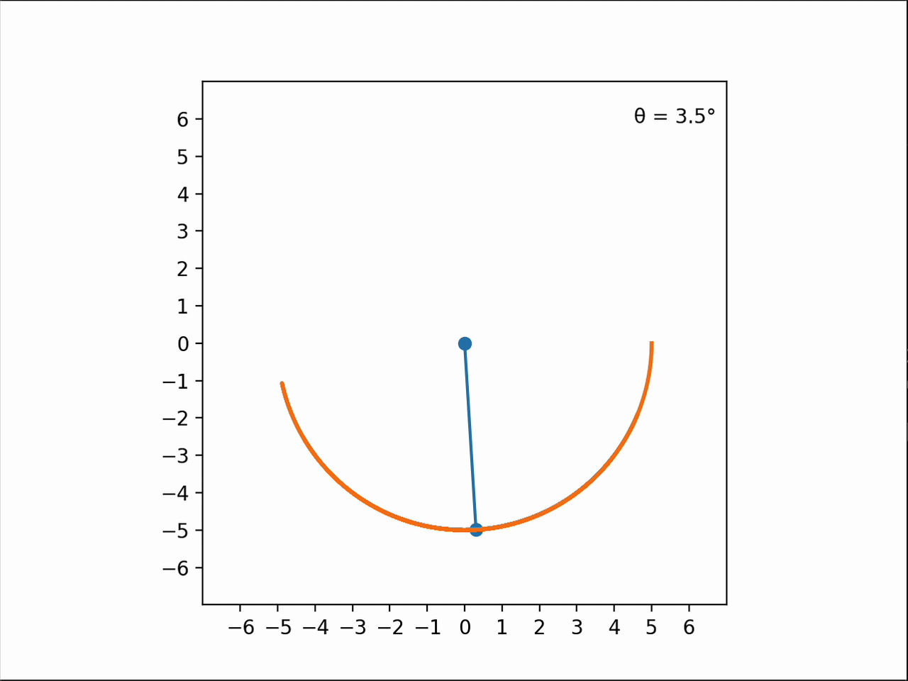

  

# Pendulum Simulation

A Python simulation of a damped pendulum, built by numerically solving its 2nd order differential equation and visualizing its motion with Matplotlib.

## Mathematical Model

The pendulum is governed by the nonlinear differential equation:

$$
\ddot{\theta}=-\mu\dot{\theta}-\frac{g}{L}\sin(\theta)
$$

where:

- $\theta$ — angular displacement
- $\dot{\theta}$ — angular velocity
- $\mu$ — damping coefficient
- $g$ — gravitational acceleration
- $L$ — pendulum length

### Numerical Solution

The equation is solved using the **semi-implicit Euler method**, approximating changes over small time steps $\Delta t=0.01$ s:

$$
\dot{\theta}_{n+1}=\dot{\theta}_n+\ddot{\theta}_n\Delta t
$$

$$
\theta_{n+1}=\theta_n+\dot{\theta}_{n+1}\Delta t
$$

The resulting angles are converted into Cartesian coordinates:

$$
x=L\sin(\theta),\qquad y=-L\cos(\theta)
$$

These coordinates are animated using Matplotlib's `FuncAnimation`, updating the pendulum's position at each frame.

## Technologies

Python · NumPy · Matplotlib
